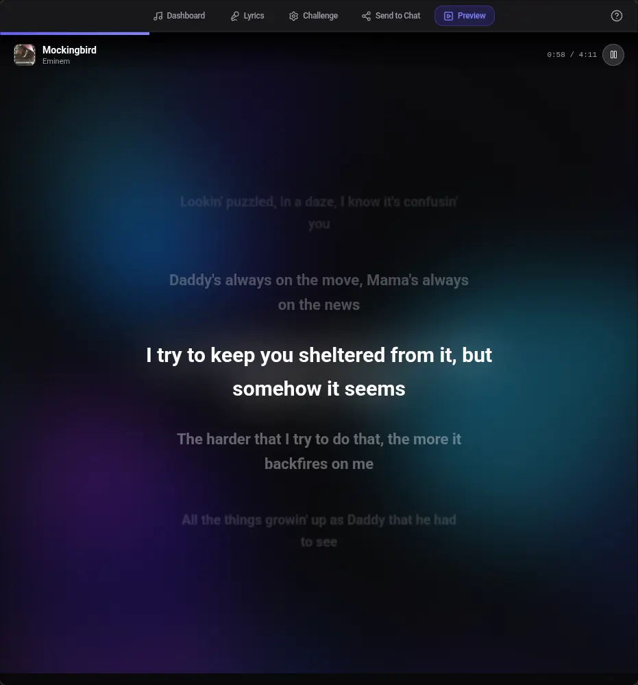
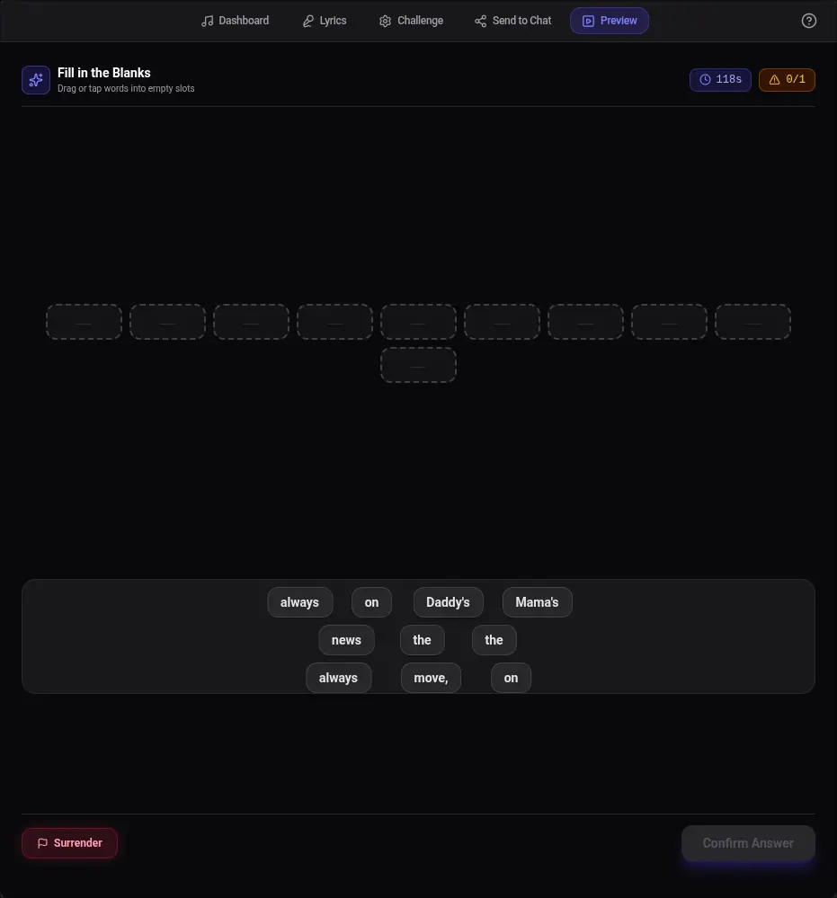

<p align="center">
  
</p>
<h1 align="center">Don't Miss The Lyrics!</h1>

**Don't Miss The Lyrics!** is a [webxdc](https://webxdc.org) app that runs inside **Delta Chat**, an interactive music-challenge builder: upload a track, sync the lyrics, turn lines into puzzles, then package a playable game and send it straight into the chat:

- 🎵 **Audio & video support** — Drop in a song or video; title, artist, cover art, and embedded lyrics are auto-extracted when available
- 📝 **Lyric sync** — Add lines, mark instrumentals, set timestamps while the track plays, or import an LRC file
- 🧩 **Jumbled blanks** — Hide words on one or more lines; players drag the shuffled tokens back into place under a time limit and error budget
- ❓ **Multiple-choice challenges** — Turn a line into a 4-option quiz with a correct answer and optional explanation
- 📋 **Pre- & post-game questions** — Optional quiz rounds before the song starts and after it ends

## Screenshot

 

## Development

The app is built with React, Vite, and Tailwind CSS.

```bash
pnpm install
pnpm dev              # development server on http://localhost:3000
pnpm build            # production build → dist/
```

The creator runs in the browser with IndexedDB persistence. Use the **Preview** tab to test a challenge locally; use the **Packager** tab to generate a playable `.xdc` file.

To test real chat integration:

1. Build a challenge in the creator and download the `.xdc` from the Packager step
2. Send that `.xdc` into any supported messenger (like Delta Chat) — recipients open it and play the interactive lyric game
